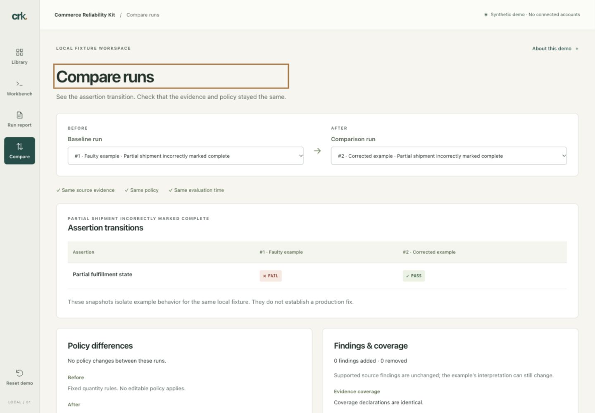

# Commerce Reliability Kit: Order and Inventory Integration Testing

Open-source tools for reproducing, diagnosing, and testing **order, fulfillment, and inventory integration failures** using explicit evidence and deterministic scenarios.

An order is marked complete after one shipment, but units remain outstanding. Reproduce the failure, inspect the supporting records, test corrected behavior, and share a report that explains the result.

[](https://github.com/SafetyMP/commerce-reliability-kit/actions/workflows/pages.yml)

**[Try the live demo](https://safetymp.github.io/commerce-reliability-kit/)** · [Source repository](https://github.com/SafetyMP/commerce-reliability-kit) · [Apache-2.0 license](LICENSE)

> **Scope:** Early v0.1 toolkit and frontend demo. The Node CLI and library include 24 synthetic scenarios. The browser demo uses a separate six-fixture evaluator. No merchant accounts are connected, and no production integration has been validated by the demo. No versioned package release is published.

**Jump to:** [Who it helps](#who-it-helps) · [Demo](#demo) · [Integration testing](#test-your-integration) · [Quick start](#quick-start) · [Verification](#verification) · [Documentation](#documentation-map) · [Contributing](CONTRIBUTING.md)

## Who it helps

| Team | Use the kit to |
| --- | --- |
| Integration agencies | Turn recurring support cases into synthetic reproductions and share evidence with clients and connector vendors. |
| Connector engineers | Test completion, synchronization, and inventory publication behavior against explicit expectations in your own test workflow. |
| Warehouse and fulfillment software teams | Examine partial shipments, duplicate events, missing orders, and stale inventory observations across system boundaries. |
| Merchant technical teams | Understand what the available records support and prepare a reproducible issue for an integration partner. |

Start with a synthetic case before adapting a test to your own normalized evidence. The toolkit accepts files and supplied outcomes; connecting systems and collecting their records remain your responsibility.

## Demo

The [browser demo](https://safetymp.github.io/commerce-reliability-kit/) needs no installation, account, API key, or backend. Its records are synthetic, and it has no telemetry or analytics.

Follow the partial-shipment example:

1. Run the faulty example: **5 ordered, 3 fulfilled, 2 outstanding**, but the example reports the order complete.
2. Inspect the assertion and its exact supporting records.
3. Run the corrected example against the same evidence and policy.
4. Compare **FAIL → PASS**, then download JSON or a standalone HTML report.



Also explore normal synchronization delay, persistent missing orders, an inventory publication buffer, stale warehouse evidence, and duplicate shipment events. Search and category filters help you find a case; policy controls show how assumptions affect a result. See the [demo walkthrough](docs/demo-guide.md).

The demo holds up to 12 reports in memory. Refresh clears those reports; downloads preserve the selected run. Browser examples and CLI scenarios are separate fixtures, so their quantities and coverage can differ.

## Test your integration

The CLI and library support three workflows:

| Workflow | What you supply | What you get |
| --- | --- | --- |
| Reproduce a scenario | One of the 24 versioned synthetic scenarios | Deterministic findings and assertion verdicts for the declared case |
| Test integration behavior | A scenario plus outcomes or normalized captures produced by your own integration test | Assertions against the scenario's expectations, with evidence and uncertainty retained |
| Diagnose captured records | Normalized JSON, JSONL, or CSV evidence and an explicit evaluation time | Supported findings, missing prerequisites, and inspectable reports |

The implemented checks cover order presence, fulfillment quantities and deadlines, inventory comparison, and freshness. The toolkit includes schema validation, a virtual clock, JSON/HTML/JUnit reports, and qualified report comparison. Use the [CLI and library guide](docs/cli-guide.md) for faulty/corrected integration examples and CI exit codes, and the [import guide](docs/IMPORTS.md) for capture formats and coverage declarations.

### Read the result correctly

**A scenario can pass because it correctly detects an expected operational problem.** Findings describe supported operational facts. Assertion verdicts judge whether an expectation was met. A missing-order scenario can therefore have a supported missing-order finding and passing assertions.

Missing, stale, ambiguous, or incomplete evidence can make a result **INCONCLUSIVE**. Coverage and mappings are caller declarations. Agreement between records does not prove physical stock accuracy, and passing assertions do not certify a connector.

## Quick start

Use Node **22.23.2** and npm **10**. Run these commands from a new checkout:

```bash
git clone https://github.com/SafetyMP/commerce-reliability-kit.git
cd commerce-reliability-kit
npm ci --ignore-scripts
npm run build
node dist/packages/cli/index.js demo partial-shipment --output ./my-first-report
```

Open `my-first-report/report.html`. The same directory contains JSON and JUnit reports. Existing report files are never overwritten; choose a new output directory when repeating the command.

To run the browser demo locally from the same checkout:

```bash
npm --prefix apps/demo ci --ignore-scripts
npm --prefix apps/demo run dev
```

Open the local URL printed by Vite. For a production build and local preview:

```bash
npm --prefix apps/demo run build
npm --prefix apps/demo run preview
```

The root toolkit and frontend have separate committed lockfiles. Installation needs registry access or a populated npm cache; evaluation runs locally. The npm package remains private and is not published to the registry.

## Verification

After installing both sets of dependencies, run from the repository root:

```bash
npm run check
node acceptance/run-tests.mjs
npm run build
node acceptance/frontend-check.mjs
node --test scripts/publication-check.test.mjs
node scripts/publication-check.mjs --check
```

These commands cover toolkit and contract tests, frontend tests and typechecking, builds, and publication checks. There is no lint command configured. The [GitHub workflow](https://github.com/SafetyMP/commerce-reliability-kit/actions/workflows/pages.yml) validates changes and deploys the checked static artifact only from `main`. A green workflow does not establish production connector compatibility.

See [development](docs/development.md) for individual commands and [deployment](docs/deployment.md) for repository-subpath builds, browser acceptance, and rollback.

## Security, privacy, and limits

- **Synthetic demo:** no merchant accounts, customer credentials, production API calls, or external commerce updates.
- **Your own captures:** toolkit reports include accepted input evidence. Review identifiers and free text before sharing; strict schemas and import filtering do not guarantee anonymity. Never attach raw customer exports or secrets to public issues.
- **Current scope:** live collectors, provider adapters, hosted monitoring, automatic corrections, general bundles, fractional conversions, returns, B2B/EDI, and arbitrary transformations are outside the current implementation.

Report vulnerabilities through the private route in [SECURITY.md](SECURITY.md). Read [limitations](docs/limitations.md), [compatibility](docs/COMPATIBILITY.md), and the dated [source register](docs/SOURCES.md) before applying a result to a real integration.

## Community

Useful contributions include synthetic failure scenarios, reproducible correctness bugs, clearer provider-mapping assumptions, and improvements to the demo or documentation. Include the expected behavior, supporting evidence, and relevant scenario/policy versions. See [scenario authoring](docs/SCENARIO-AUTHORING.md) and [CONTRIBUTING.md](CONTRIBUTING.md).

[Support](SUPPORT.md) · [Code of conduct](CODE_OF_CONDUCT.md) · [Governance](GOVERNANCE.md) · [Roadmap](docs/roadmap.md) · [Changelog](CHANGELOG.md)

The open toolkit and scenarios are independently useful. A future commercial service may offer managed collection, hosting, collaboration, notifications, and support; those services are not implemented or required to use this repository. See the [commercial boundary](docs/COMMERCIAL-BOUNDARY.md).

Part of the [SafetyMP portfolio](https://github.com/SafetyMP/SafetyMP).

## License

Original code, documentation, and synthetic fixtures are licensed under [Apache-2.0](LICENSE). Preserve [NOTICE](NOTICE) and third-party attribution. No vendor endorsement or certification is claimed.

## Documentation map

| Topic | Start here |
| --- | --- |
| Browser scenarios and report comparison | [Demo walkthrough](docs/demo-guide.md) |
| CLI commands, library API, integration tests, and exit codes | [CLI and library guide](docs/cli-guide.md) |
| Normalized captures and evidence declarations | [Import guide](docs/IMPORTS.md) |
| Adding a reproducible synthetic case | [Scenario authoring](docs/SCENARIO-AUTHORING.md) |
| Component boundaries and supported behavior | [Architecture](docs/architecture.md) · [Compatibility](docs/COMPATIBILITY.md) |
| Setup, tests, and build commands | [Development](docs/development.md) · [CI notes](docs/CI.md) |
| Pages publication, browser checks, and rollback | [Deployment](docs/deployment.md) |
| Limitations and source uncertainty | [Limitations](docs/limitations.md) · [Sources](docs/SOURCES.md) |
